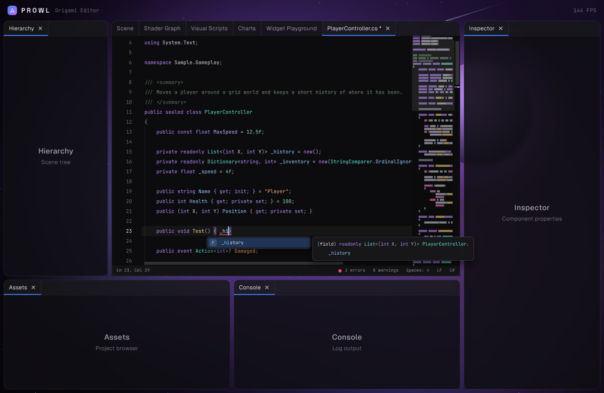

# Code Editor

A virtualized code editor with a C# IDE behind it. The editor itself lives in Origami and knows nothing
about C#. Languages plug in through `CodeLanguage`, and the Roslyn backed C# support ships separately in
`Prowl.Origami.CSharp` so Origami does not take a compiler dependency.



```csharp
var workspace = new CSharpWorkspace();
var editor = new CodeEditor(File.ReadAllText(path), new RoslynCSharpLanguage(workspace, path))
{
    FilePath = path,
};
editor.SaveRequested += () => { File.WriteAllText(path, editor.Text); editor.Undo.MarkSaved(); };

// every frame
Origami.CodeEditor(paper, "script", editor).Size(paper.Percent(100), paper.Percent(100)).Show();
```

Keep one `CodeEditor` per open file and draw it each frame. It owns the document, carets, undo history,
folds and language state. The host needs a clipboard handler on Paper (`SetClipboardHandler`) for copy and paste.

## Speed

Only visible rows are lexed, laid out and drawn. Lines are stored as separate strings, an edit only
replaces the lines it touches, and every cache (row layouts, semantic colours, minimap) is keyed by the
line's string instance, so untouched lines keep their work across edits and scrolls. Lexer state is kept
per line and relexed from an edit only until it converges again. Very long lines are laid out in windows
around the visible columns. A 200k line file draws in under a millisecond a frame.

## Features

- Syntax colouring from a line based lexer, refined by semantic colours from the language session
- Multiple carets (Alt+click, Ctrl+Alt+Up/Down, Ctrl+D, Ctrl+Shift+L) and box selection (Alt+Shift+drag)
- Undo and redo that merge typing by word, including edits made straight on the `CodeDocument`
- Auto closing pairs, overtyping closers, smart indent and outdent, wrap selection in brackets or quotes
- Folding of braces, `#region` blocks and comment and using runs, with a placeholder you click to open
- Find and replace with case, whole word and regex options, replace with regex groups, select all matches
- Minimap, overview ruler with errors and carets, indent guides, rulers, whitespace rendering
- Bracket matching, occurrence highlighting, current line highlight, font zoom (Ctrl+wheel)
- Glyph margin with host owned `Markers` (breakpoints, execution line, bookmarks) that follow edits
- Status bar with caret position, selection size, error and warning counts, indentation and line ending

With a language session (C# through Roslyn):

- Completion with fuzzy camel hump matching and a description panel
- Hover info and diagnostics on hover, squiggles under errors and warnings
- Signature help with overloads and the active parameter
- Go to definition (F12 or Ctrl+click), find all references (Shift+F12), symbol highlights
- Rename (F2), format document (Shift+Alt+F), quick actions such as add using (Ctrl+.)

## Keys

| Keys | Does |
|------|------|
| Ctrl+Z, Ctrl+Y, Ctrl+Shift+Z | Undo, redo |
| Ctrl+X, Ctrl+C, Ctrl+V | Cut, copy, paste. With no selection these work on whole lines |
| Ctrl+D | Select word, then add the next match |
| Ctrl+L | Select line |
| Ctrl+/ , Ctrl+Shift+A | Toggle line comment, toggle block comment |
| Alt+Up/Down, Shift+Alt+Up/Down | Move lines, duplicate lines |
| Ctrl+Shift+K | Delete lines |
| Ctrl+Enter, Ctrl+Shift+Enter | Insert line below, above |
| Tab, Shift+Tab, Ctrl+], Ctrl+[ | Indent, outdent |
| Ctrl+F, Ctrl+H, F3, Shift+F3 | Find, replace, next match, previous match |
| Ctrl+G | Go to line, accepts `line:column` |
| Ctrl+Space, Ctrl+Shift+Space | Completion, signature help |
| Ctrl+Shift+[ , Ctrl+Shift+] | Fold, unfold at caret |
| Ctrl+K Ctrl+0, Ctrl+K Ctrl+J | Fold all, unfold all |
| Ctrl+K Ctrl+C, Ctrl+K Ctrl+U | Comment, uncomment |
| Ctrl+K Ctrl+D, Ctrl+K Ctrl+X | Format document, trim trailing whitespace |
| Ctrl+Shift+\ | Go to matching bracket |
| Ctrl+U, Ctrl+Shift+U | Upper case, lower case |
| Ctrl+S | Raises `SaveRequested` |

## Languages

`CodeLanguage` holds what an editor knows without a compiler: the `ICodeLexer`, comment syntax, bracket and
auto closing pairs, and indentation rules. `CSharpLanguage` is the built in lexical C#. Override
`CreateSession` to return a `CodeLanguageSession`, whose async methods supply completion, hover,
diagnostics and the rest. The editor calls them on the UI thread, they do their work on background
tasks, and results are applied the next time the editor is drawn. Offsets passed to a session join lines
with a single `'\n'`.

A lexer gets one line and the state the previous line ended in, and returns the state for the next line.
Pass `null` tokens and it only needs to track state, which is how the editor walks huge files cheaply.

## C# with Roslyn

`CSharpWorkspace` is one Roslyn project. With no references it uses the running runtime's assemblies.
A host such as the Prowl editor passes its own script references instead:

```csharp
var workspace = new CSharpWorkspace(references);
workspace.SetPreprocessorSymbols(new[] { "PROWL_EDITOR" });
workspace.AddOrUpdateDocument("Assets/Scripts/Enemy.cs", enemySource);
```

Other scripts added with `AddOrUpdateDocument` give cross file completion, go to definition and rename.
Results that land in other files come back through `NavigateRequested` and `ExternalEditsRequested` for the
host to open or apply.
